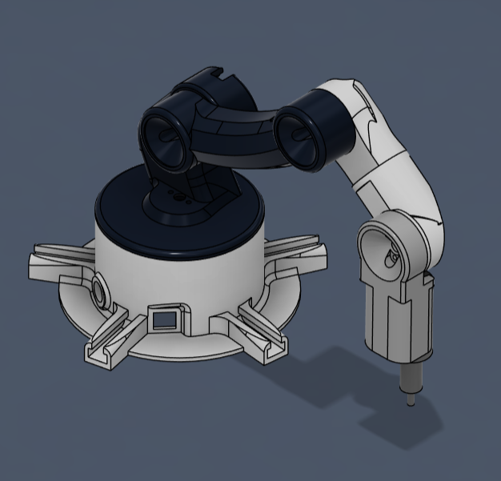
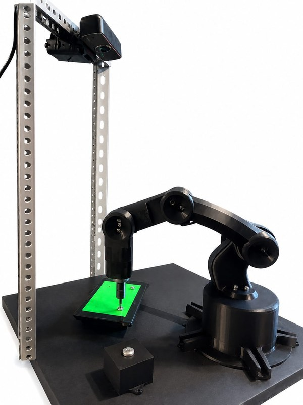
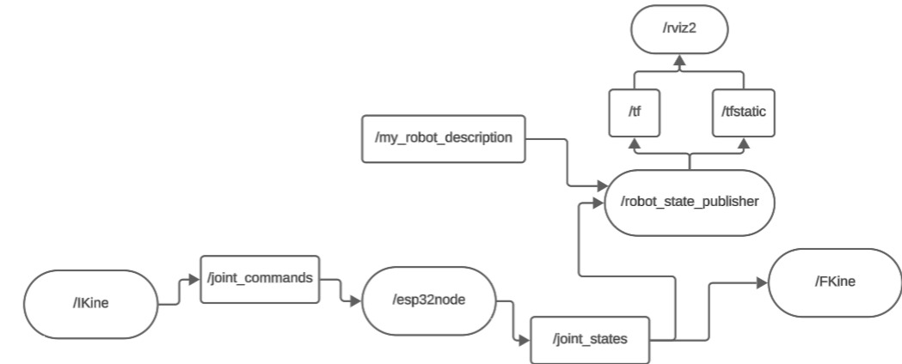
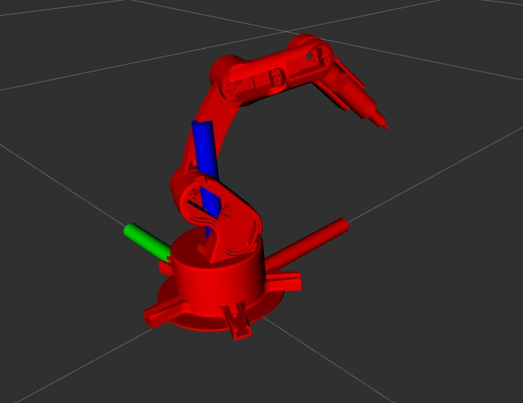
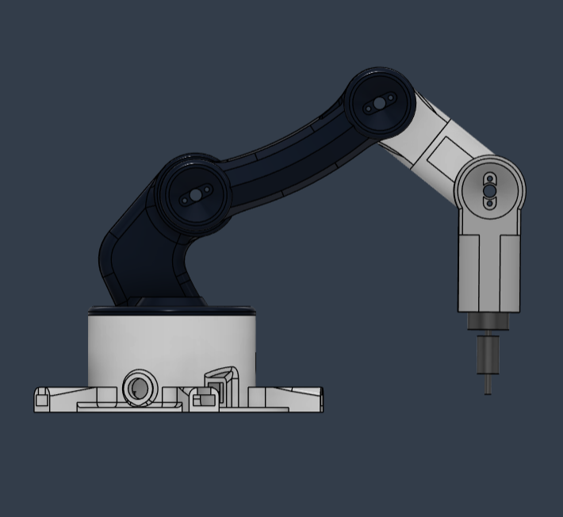
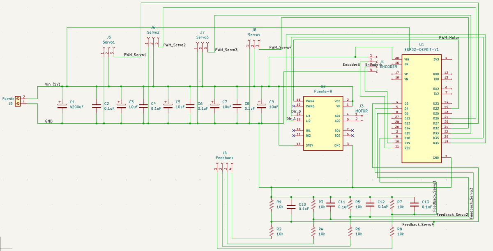
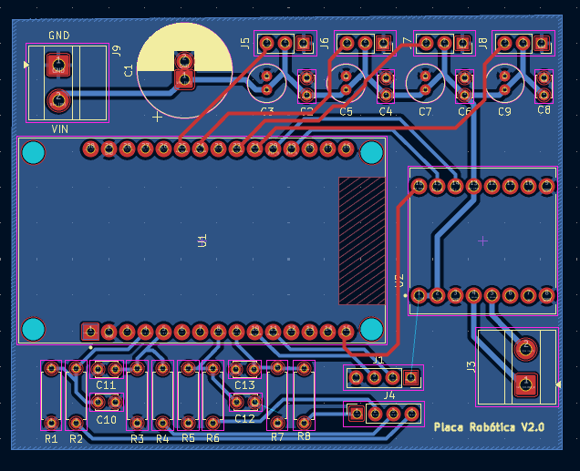
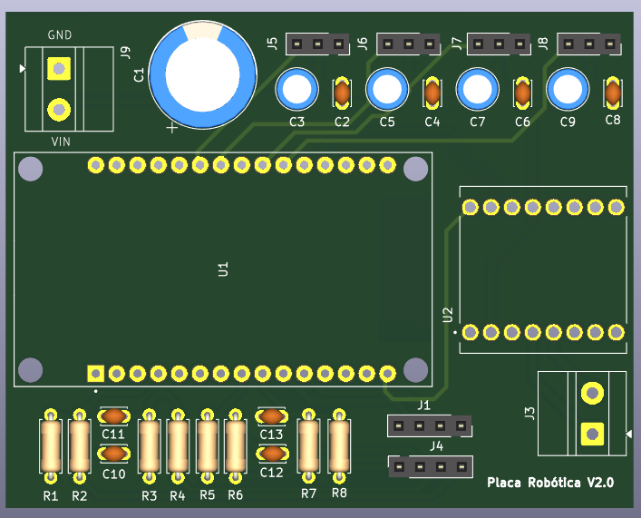
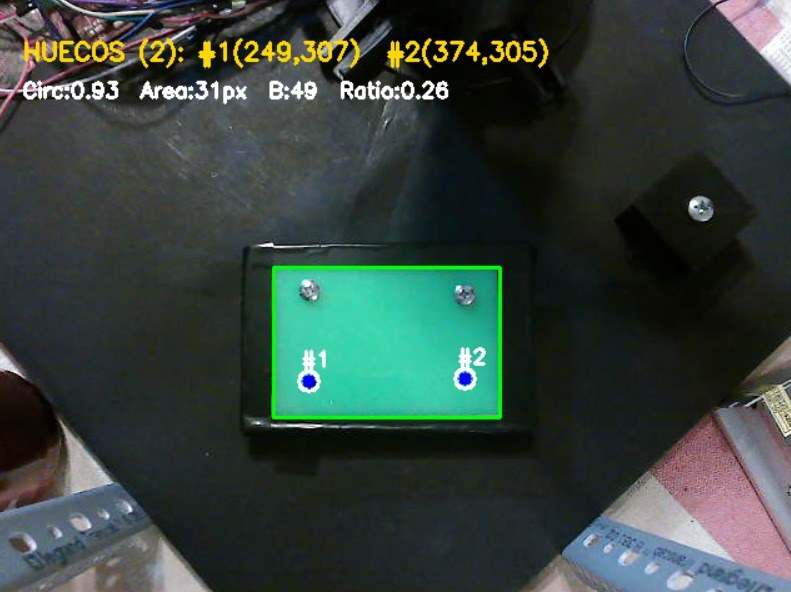
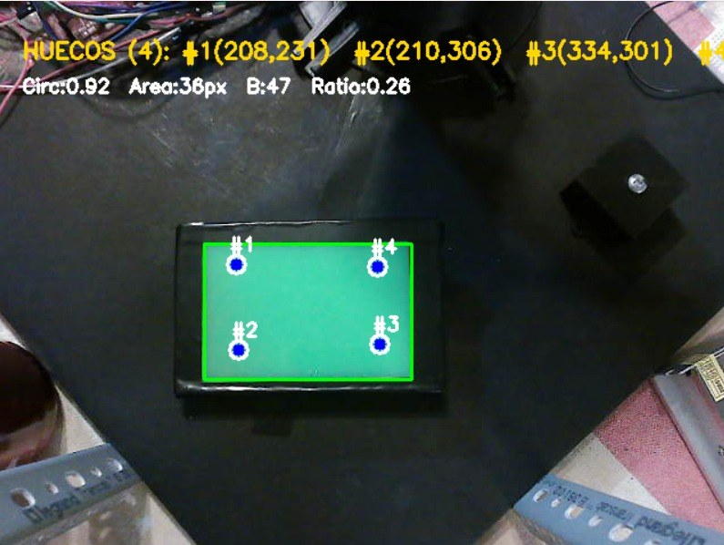

# 4-DOF Serial Manipulator for Automated PCB Screwing

> Design, fabrication, custom PCB integration, and ROS 2 / micro-ROS high-level control of a **4-DOF R-R-R-R serial manipulator** with an overhead computer-vision system and decoupled DC screwdriver end-effector for automated PCB fastening.

  
  

**Demo Video:** [Watch the physical 4-DOF manipulator in action (YouTube Shorts)](https://youtube.com/shorts/tFkdfhnoOUY?feature=share)

---

## Key Results

| Metric | Result |
| :--- | :---: |
| **Mean Cartesian Positioning Error** | **0.8 mm** |
| **Maximum Positioning Error** | **2.0 mm** |
| **PCB Screw-Hole Detection Accuracy** | **100%** |
| **Average Fastening Cycle Time** | **15 s** |
| **ROS 2 ↔ ESP32 Control Rate** | **50 Hz** ($\Delta t = 20\text{ ms}$) |
| **Workspace Coverage** | $\approx 280\text{ mm}$ safe XY radius ($100 \times 100\text{ mm}$ PCB cell) |

---

## My Role

- **Owned high-level control architecture:** Designed and implemented the **ROS 2 Humble** node graph, forward & inverse kinematics (Denavit–Hartenberg + Damped Least Squares), coordinate transformations, quintic trajectory generation, RViz2 URDF synchronization, and overhead vision integration.
- **Embedded bridge:** Integrated the **ESP32-DEVKIT-V1** low-level controller via **micro-ROS (Serial)** at **50 Hz**, closing the loop with analog potentiometer feedback.

---

## System Architecture

### 1. ROS 2 & micro-ROS Distributed Control Graph

The architecture splits high-level spatial planning (PC running ROS 2 Humble) from real-time joint actuation and analog acquisition (ESP32 running micro-ROS at 50 Hz):

  

- **`/IKine`**: Consumes Cartesian target coordinates `[x, y, z]` from the overhead vision pipeline, computes inverse kinematics via iterative **Damped Least Squares (DLS)** ($\lambda = 0.03$, convergence threshold $\epsilon = 1\text{ mm}$), plans smooth **quintic polynomial trajectories**, and publishes `sensor_msgs/msg/JointState` on `/joint_commands`.
- **`/esp32node`**: Bidirectional **micro-ROS** serial bridge at 50 Hz; streams `/joint_commands` to the ESP32 and publishes live potentiometer-measured joint angles on `/joint_states`.
- **`/robot_state_publisher` & `/rviz2`**: Synchronizes the live digital twin (`URDF` / `/tf`) with physical joint telemetry, while `/FKine` validates end-effector Cartesian accuracy in real time.

  

### 2. Kinematics & Low-Level Joint Control

**Denavit–Hartenberg Parameters** (calibrated in meters & radians):

| Joint $i$ | $d_i$ (m) | $\theta_i$ (rad) | $a_i$ (m) | $\alpha_i$ (rad) |
| :---: | :---: | :---: | :---: | :---: |
| 1 | `0.1270` | $\theta_1^*$ | `-0.0139` | $-\pi/2$ |
| 2 | `0.0000` | $\theta_2^* - \pi/2 + 0.10$ | `0.1200` | `0.0000` |
| 3 | `0.0000` | $\theta_3^* + 0.08$ | `0.0828` | `0.0000` |
| 4 | `0.0000` | $\theta_4^* + 0.09$ | `0.1350` | `0.0000` |

**Control Strategy Comparison (Physical Hardware):**
- **Approach 1 — Point-to-Point DLS Inverse Kinematics + Local Filtered PD (Selected):** Computes absolute target joint angles via DLS before motion; each joint runs a discrete PD controller ($K_p = 5.0$, $K_d = 0.6352$) with a first-order low-pass derivative filter ($\alpha = 0.50$, $\tau_c = 0.02\text{ s}$) to eliminate ADC quantization jitter. Achieved superior repeatability without cumulative drift.
- **Approach 2 — Resolved-Rate Kinematic Control ($\dot{q}_{\text{ref}} = J^+ K_x e$):** Smooth in simulation, but sensitive to servo deadband and Euler integration drift on physical MG996R hardware.

---

## Mechanical & Electronic Design

### Mechanical Structure
- **4-DOF Elbow Manipulator** in 3D-printed PLA (40% grid infill, 1.2 mm walls) with **hollow internal link routing** to protect power/feedback harnesses and minimize parasitic torque.
- **Static worst-case torque at Joint 2:** $T_2 = 0.9426\text{ N}\cdot\text{m}$ ($\approx 9.61\text{ kg}\cdot\text{cm}$), actuated by metal-gear **MG996R** servos ($11\text{ kg}\cdot\text{cm}$ at 6.0 V).
- **Decoupled floating DC end-effector** isolates axial fastening vibrations from the serial links.

  

### Custom Electronics — PCB V2.0 (*Placa Robótica V2.0*)
- **MCU:** `ESP32-DEVKIT-V1` generating 50 Hz PWM for 4 servos + H-bridge DC driver (`Dir_A`, `Dir_B`, `PWM_Motor`) + quadrature encoder interface.
- **Power & EMI Decoupling:** `4200 µF` bulk electrolytic capacitor at `Vin` plus distributed `10 µF` + `100 nF` decoupling pairs per servo port to prevent brownouts during simultaneous peak torque.
- **Analog Feedback Conditioning:** `10 kΩ` voltage dividers + first-order **RC low-pass filters ($f_c \approx 160\text{ Hz}$)** ahead of the 12-bit ESP32 ADC channels reading internal servo potentiometers.

  

  
  

---

## Computer Vision & Results

An overhead gantry mounts the camera perpendicular to the PCB plane to eliminate perspective distortion, detecting both empty mounting holes and fastened screws with **100% detection accuracy**:

  
  

---

## Documentation

Technical engineering reports are included in [`docs/`](docs/):
- [`forward_kinematics_dh_model.pdf`](docs/forward_kinematics_dh_model.pdf) — Denavit–Hartenberg modeling and homogeneous transformation derivation.
- [`system_design_and_ros2_control.pdf`](docs/system_design_and_ros2_control.pdf) — Full CAD, static torque analysis, PCB V2.0 design, ROS 2 / micro-ROS graph, DLS inverse kinematics, and comparative experimental validation.

---

## Team & Context

- **Course:** Fundamentals of Robotics — University of Engineering and Technology (UTEC), 2026-I
- **Team:** Sergio E. Beltran Abalos, Alvaro V. Gonzalez Llanos, Luis M. Fermin Arratea, Flavia L. Palacios Davalos, Carlos A. Lam Nishiyama
- **Advisor:** Prof. Jhedmar Callupe Luna
